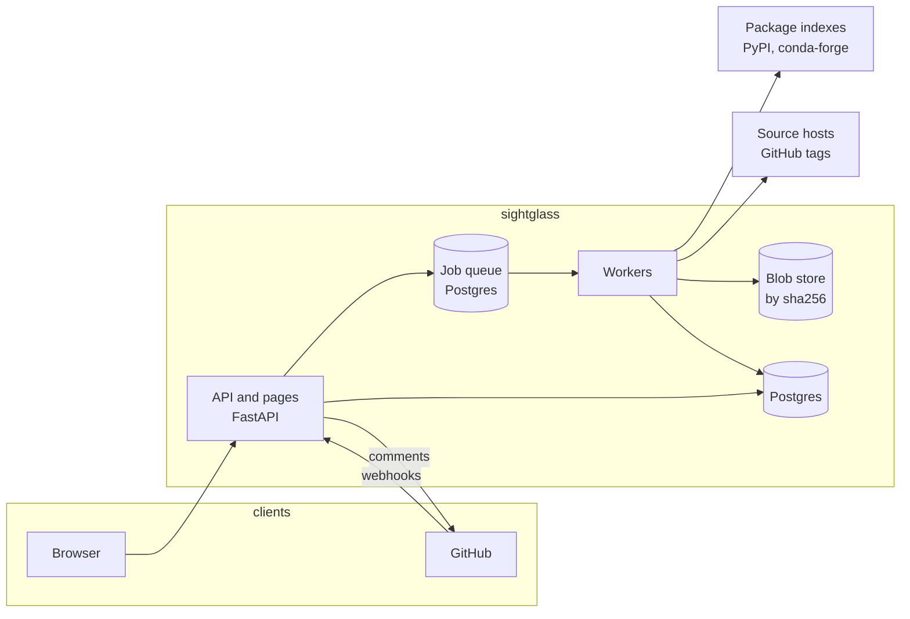

# Sightglass design

Status: draft, 2026-10-16; stack and layout decided 2026-10-17. The project is scaffolded; no analysis is built yet.

## Summary

Sightglass shows what a package release actually ships. It compares the files people install from a package index
with the previous release and with the project's git tag, and reports the differences that matter for supply chain
security: a different publisher, a dropped attestation, files that aren't in the source, new code that runs on import.

It is a hosted web service with two parts:

1. **Release diff pages** (phase 1). A public, linkable page for any pair of releases, such as
   `/pypi/orbit-client/2.4.1...2.5.0`.
2. **Pull request review** (phase 2). A GitHub App that comments on pull requests that change a lockfile and links to
   a review page listing every changed package, where it sits in the dependency tree, and its release diff.

A sight glass is the window in a pipe or tank that shows what's actually flowing through it.

## Problem

Dependency updates arrive as pull requests from Dependabot, Renovate or `pixi update`. A reviewer sees a version bump
and a lockfile diff of hundreds or thousands of lines, and approves it without reading. Nothing in that flow shows what
the new release contains.

Recent supply chain attacks went through this gap. Compromised maintainer accounts and CI tokens produced releases that
looked like routine bumps. The tell-tale signs were there in the published files and metadata: a release uploaded
outside the usual workflow, code in the wheel that isn't in the repository, a new network call at import time. Nobody
was looking at them at the moment of the merge.

Existing tools cover other parts of the problem:

| Tool | What it does | What it doesn't do |
|---|---|---|
| Dependabot, Renovate | Open update pull requests, link release notes | Look inside the published files |
| GitHub dependency-review-action | Known vulnerabilities, licenses, OpenSSF Scorecard | Look inside the published files |
| Socket | Release analysis and alerts | Open source, self-hosting, conda |
| GuardDog | Heuristic malicious-package detection, as a CLI | Release-to-release diff, review workflow, web view |
| deps.dev | Package metadata and dependency graphs | Content analysis |

Sightglass fills the gap with something open, self-hostable, ecosystem-neutral (PyPI and conda first), and built
around the review moment.

## Goals

- Show, for any two releases of a package, which installed files changed, and why that might matter.
- Check whether the published files match the git tag they claim to come from.
- Make the result a stable, shareable URL that anyone can open without an account.
- Fit into pull request review with one comment and one link, not a wall of alerts.
- Analyze each release once, for everyone, so the public service stays cheap to run.
- Never run package code.

## Non-goals

- **Not a vulnerability scanner.** No vulnerability database and no CVE matching. Sightglass works alongside OSV,
  Grype and dependency-review-action.
- **Not a verdict engine.** It presents facts and ranks them. It doesn't label packages malicious or safe. A reviewer
  decides.
- **No dynamic analysis.** No sandboxed installs or runtime tracing in any planned phase.
- **Not a package index or mirror.** It doesn't serve packages for installation.

## Users

| User | When they use it | What they need |
|---|---|---|
| App maintainer | Reviewing a dependency update pull request | Which changes need a look, and the evidence for each |
| Library maintainer | Right after publishing a release | Confirmation the release came out as intended: attestation present, matches the tag |
| Security researcher | Investigating a suspicious release | A quick, linkable view of what changed, to cite in a report or advisory |
| Platform or security team | Running it for their organization | Self-hosting, a policy file, private repositories |

## Product

### Release diff page (phase 1)

URL: `/{ecosystem}/{package}/{from}...{to}`, plus `/{ecosystem}/{package}/{version}` for a single release compared
with its predecessor.

Sections, in order:

1. **Header.** The package and both versions, version pickers, the artifact being compared (which wheel, or the sdist)
   and a copy-link button.
2. **Release history.** A timeline of every release, showing for each one how it was published (trusted publisher or
   not) and whether it has an attestation. A break in the pattern is visible at a glance. Clicking a release compares it
   with the previous one.
3. **Signals.** The ranked findings for this pair (see [Signals](#signals)).
4. **Files.** A treemap of the installed files, sized by bytes and colored by status (added, changed, removed, same),
   with flagged files outlined. A list view sorts flagged files first.
5. **Diff.** A unified diff of the selected file, against the previous release or against the git tag. Lines that
   triggered a signal are marked.
6. **Source check.** Every package file in the wheel, classified as matching the tag, differing from it, or missing
   from it. Packaging metadata generated at build time is excluded.
7. **Release facts.** A before-and-after table: publish date, publisher, attestation, build tool, file count, size,
   hashes and declared dependencies.

Mockup: [`mockups/release-diff.html`](mockups/release-diff.html).

### Pull request review (phase 2)

A GitHub App watches pull requests that change a supported lockfile. It posts one comment (and edits it on later
pushes) that summarizes the change and lists the packages that need a look, with a link to the review page.

The review page has:

- A queue of changed packages, sorted with the ones that need a look first, filterable by platform.
- A dependency graph showing where each change sits and the path from the project to it, answering "why is this
  package in my lockfile now?"
- For the selected package: signals, release facts, and the release diff from phase 1.
- A per-package decision, "Looks fine" or "Hold back", and a generated Markdown review comment. For a held-back
  package, the comment includes the command that keeps the old version (for example
  `pixi add --pypi "orbit-client==2.4.1"`).

Platform matters for pixi and conda lockfiles. A package resolved only for `osx-arm64` is never installed by CI that
runs on `linux-64`, so the page calls that out.

Mockup: [`mockups/lockfile-lens.html`](mockups/lockfile-lens.html) (built under the working name Lockfile Lens).

### Later

- conda packages (conda-forge first), then npm.
- More lockfile formats: `uv.lock`, `poetry.lock`, `package-lock.json`, `pnpm-lock.yaml`.
- A policy file in the repository, for example "hold any update without an attestation", which turns signals into a
  check run that can block a merge.
- Self-hosted mode for private repositories and internal indexes.
- A command-line client that prints a release diff summary and links to the page.

## Signals

Each signal has a level: **high** (look before merging), **check** (worth a glance), **note** (context) or **clean**
(nothing unusual). Signals are facts with evidence attached, never verdicts.

| Group | Signal | Level | Evidence |
|---|---|---|---|
| Provenance | Attestation present in the previous release, missing in this one | high | PyPI Integrity API (PEP 740) |
| Provenance | Attestation's publisher identity changed (different repository or workflow) | high | Attestation contents |
| Publisher | Not published through the trusted publisher that published recent releases | high | Attestation publisher, where available |
| Provenance | Some files in the release are attested and others aren't | check | Simple API `provenance` per file |
| Provenance | Built on a self-hosted runner where earlier releases used hosted runners | check | Certificate runner environment |
| Provenance | Built from a pull request ref | check | Certificate source ref |
| Provenance | Deployment environment removed from the publisher | check | Attestation publisher |
| Provenance | Deployment environment added, or build trigger changed | note | Attestation publisher, certificate build trigger |
| Source match | A package file in the wheel isn't in the git tag | high | Wheel contents vs. tag archive |
| Source match | A package file differs from the same path in the git tag | high | Line diff |
| Source match | The wheel contains a file the sdist doesn't | high | Wheel vs. sdist |
| Behavior | New code that runs at import time in `__init__.py` | high | Added module-level statements |
| Behavior | New network, subprocess, `exec`/`eval`, or encoded-payload patterns in added lines | high | Pattern rules |
| Behavior | New install-time hooks (sdist build scripts, npm `install` scripts) | high | Build metadata |
| Binaries | New compiled files with no corresponding source in the sdist | check | File type and sdist contents |
| Dependencies | New declared dependency | check | `Requires-Dist` |
| Dependencies | Dependency only on some platforms or markers | check | Environment markers |
| Build | Build backend changed (for example hatchling to setuptools) | check | `WHEEL` `Generator` |
| Timing | Published in the last 7 days | check | Upload time |
| Timing | First release after a long gap | note | Upload times |
| Name | Package name close to a popular package | check | Edit distance against a top-packages list |
| Dependencies | Version constraint changed, or a dependency removed | note | `Requires-Dist` |

Behavior signals use static analysis of added lines only, so an unchanged `urllib.request` call in a file that has
always had one doesn't fire. They come from two sources ([research](research/pattern-rules.md)):

- **Sightglass's own rules**, which parse Python with `ast`, produce the high-level behavior signals in the table above.
- **GuardDog's YARA rules**, vendored at a pinned release with its license and notice, run in the Rust core with
  YARA-X. Their matches are reported at **check** (GuardDog `threat-*` rules) or **note** (`capability-*` rules),
  never high, and name the GuardDog rule in the evidence.

False positives are expected. Telemetry can be legitimate, and some build systems generate files that aren't in the
repository. The page shows the evidence so a reviewer can decide quickly, and per-project baselines (phase 3) can learn
what's normal for a package.

## Architecture



### Components

- **API and pages.** FastAPI. Serves the JSON API, receives GitHub webhooks and serves the built frontend. Requests
  for an analysis that doesn't exist yet enqueue it and return a pending state that the page polls or streams over
  server-sent events.
- **Workers.** Python processes that run analysis jobs: fetch, unpack, diff, run signal rules, store results. Unpacking,
  hashing, file typing and line diffs run in the Rust core (`sightglass._core`). No job runs package code.
- **Job queue.** [procrastinate](https://procrastinate.readthedocs.io/) on the application database, so the first
  deployment needs only Postgres and a blob store, not Redis. One job per release pair: a queueing lock deduplicates
  requests for a pair already queued, and a lock on the same key keeps two workers off one pair. Transient failures
  (an index or GitHub down) retry with exponential backoff; worker heartbeats let jobs from a crashed worker be
  requeued. Chosen over a hand-written `SKIP LOCKED` table for the heartbeats, LISTEN/NOTIFY pickup and periodic
  jobs it already has.
- **Postgres.** Packages, releases, artifacts, file indexes, analyses, signals, pull request reviews and decisions.
- **Blob store.** Unpacked file contents keyed by sha256. Local disk at first; S3-compatible storage later.

### Analysis pipeline for a release pair

1. **Resolve.** Look up both releases in the index. Pick the artifacts to compare: the same wheel tag in both releases
   when possible (preferring `py3-none-any`, then the most widely installed platforms: manylinux x86_64, macOS
   arm64, Windows amd64, then abi3 and the newest CPython), and the sdist (`.tar.gz` over `.zip`). When the platform
   tags changed between releases (a newer manylinux or CPython), wheels for the same OS and architecture are paired
   and the pair is marked `platform_changed`. Every other possible pair is kept for the artifact picker.
2. **Fetch.** Download each artifact once, verify its hash against the index, and record its size.
3. **Unpack.** Extract into a file index, with each file's path, size, sha256 and type. Store each unique file
   content in the blob store once.
4. **Fetch provenance.** Query the PyPI Integrity API for each artifact's attestations, and record whether there are
   any, the publisher identity, and the certificate's source commit, ref, runner and trigger
   ([research](research/pypi-publisher-data.md)). PyPI verifies attestations on upload; Sightglass verifying them
   again is #96.
5. **Fetch the source.** When an attestation names the source commit, fetch that commit's archive. Otherwise
   find the repository from the project URLs and find the tag ([research](research/tag-discovery.md)) in git's ref
   advertisement (what `git ls-remote` reads, so no API token or REST rate limit). Archives come from
   `codeload.github.com` by commit SHA only. Unpack it the same way. Anything that fails is a "couldn't compare"
   result with a reason, never a guess.
6. **Diff.** Pair files by path (normalizing the `dist-info` and `.data` directory names and the sdist's top-level
   directory), classify each pair as added, removed, changed or same, and compute line diffs for text files. The source
   check looks for each package file under the source root most package files are found under (`src/`, `python/`, or
   the repository root), then under the other candidate roots, and classifies it as matching, differing or missing.
   `.dist-info`, `PKG-INFO` and `.egg-info` are build output and are left out of the source check. Diffs compare lines as bytes (Myers, from the `similar` crate) and skip files over 4 MiB or
   100,000 lines on either side, reporting them as too large to diff. A 2 second deadline bounds pathological
   inputs; past it the diff is still correct but may not be minimal, and is marked approximate.
7. **Run signal rules.** Each rule is a pure function from the pair analysis to zero or more signals with evidence.
8. **Store.** Persist the pair analysis and signals. Analyses are immutable for a given rule-set version and are
   recomputed when the rules change.

Every step is cached by content. A file seen in a hundred releases is stored and scanned once, and a release pair is
analyzed once for every user who asks for it.

### Pull request flow (phase 2)

1. A `pull_request` webhook arrives for a change that touches a supported lockfile.
2. The worker fetches the base and head versions of the lockfile through the GitHub API.
3. A lockfile parser produces, for each platform, the resolved packages and the dependency edges. For `pixi.lock`,
   `py-rattler` reuses the parser behind pixi.
4. The diff of the two resolutions gives the changed packages and their paths from the project.
5. Each changed package gets a release pair analysis, from cache when possible.
6. The App posts or updates its comment and the review page is ready.

## Data model

Tables, simplified. The phase 1 ones are defined in `backend/src/sightglass/db/models.py`, with Alembic migrations:

| Table | Key columns |
|---|---|
| `package` | ecosystem, name (normalized) |
| `release` | package, version, published_at, yanked |
| `artifact` | release, filename, kind (wheel, sdist, conda), sha256, size, upload metadata, provenance status (unknown, absent, present) |
| `attestation` | artifact, publisher kind, repository, workflow, environment, service account email, source commit, source ref, runner environment, build trigger, run URL, verified (by Sightglass itself), raw bundle |
| `ownership_snapshot` | package, seen_at, organization, roles (account and role) |
| `file` | artifact or source snapshot (exactly one), path, sha256, size, type |
| `blob` | sha256, size, storage location (null when too large to keep) |
| `source_snapshot` | package, repository, commit, ref, archive sha256, origin (attestation or tag), tag pattern |
| `analysis` | from artifact, to artifact, rule-set version, status, error, created_at, finished_at |
| `signal` | analysis, rule id, level, message, evidence (JSON) |
| `review` | repository, pull request number, base and head lockfile sha |
| `review_change` | review, package, from and to versions, platforms, dependency path |
| `decision` | review_change, user, value (fine, hold), created_at |

## API sketch

| Route | Purpose |
|---|---|
| `GET /api/{eco}/{pkg}/releases` | Release history with publisher and attestation summary |
| `GET /api/{eco}/{pkg}/{from}...{to}` | Pair analysis: files, signals, facts; `202` while pending |
| `GET /api/{eco}/{pkg}/{from}...{to}/files/{path}` | Diff for one file, against the previous release or the tag |
| `POST /webhooks/github` | GitHub App webhooks |
| `GET /api/reviews/{owner}/{repo}/{number}` | Review page data |
| `PUT /api/reviews/{owner}/{repo}/{number}/decisions/{package}` | Record a decision (signed-in GitHub users with access) |

Pages mirror the API paths without `/api`.

## Security of the service

Sightglass processes hostile input by design, so the workers are the main attack surface.

- **Never execute package code.** No installs, no builds, no imports. Only reading archives and text.
- **Safe unpacking** (`sightglass-core::unpack`). Reject absolute paths and `..` traversal, backslashes, drive letters,
  duplicate paths, symlinks and hard links outside the root, and device files, FIFOs and sockets. Links inside the root
  are recorded in the index but never created on disk. Limits are enforced on the bytes actually decompressed:
  4 GiB in total, 1 GiB per file, 100,000 files, and 100 times the archive's size once 16 MiB have been decompressed.
  Extraction writes only into a new directory and removes it if the archive is refused partway through. Large
  binaries are hashed and typed but not stored.
- **Isolation.** Workers run unprivileged, in containers with no credentials except write access to their own blob
  prefix and database role, and with outbound network limited to the indexes and source hosts.
- **Escaping.** File contents are untrusted text in the browser. The frontend renders them as text only, never as HTML.
- **GitHub App permissions.** Read access to contents and metadata, write access to pull requests (for the comment)
  and later checks. Nothing else. Webhook signatures are verified.
- **Rate limits.** Per-client limits on analysis requests, so the public service can't be used to make it download
  arbitrary large artifacts in a loop.

## Stack

| Part | Choice | Why |
|---|---|---|
| Environment and tasks | pixi | One environment for Python, Rust and Node, conda-forge first |
| Backend | Python 3.14 only, FastAPI, structlog | Fast to build; the analysis libraries are in Python. A hosted service fixes its own runtime, so there's no version matrix |
| Jobs | procrastinate on Postgres | One fewer service to run; crashed-worker recovery and periodic jobs built in |
| Database | Postgres | Relational data with JSON evidence columns |
| Lockfile parsing | py-rattler for `pixi.lock`; small parsers for others | Reuse pixi's own parser |
| Frontend | React, Vite and TypeScript, built with Node from conda-forge and pnpm | Node as a build tool only |
| UI components | React Aria Components, styled with CSS modules on the mockups' tokens | Accessible behavior without a visual system to override; not MUI |
| Visuals | SVG with D3 helpers for the treemap, timeline and graph | Small, themeable, accessible |
| Rust | Archive unpacking, hashing, file typing and line diffs, in `sightglass-core`, exposed to Python through PyO3 and maturin | Memory safety for the code that parses hostile archives, `cargo-fuzz` for the unpacker, and speed on large files |
| Deployment | Docker Compose on one VM at first | Same artifacts later for self-hosting |

Repository layout:

```
pixi.toml                       one workspace for Python, Rust and Node
backend/
  pyproject.toml                Python tool config and the maturin build
  Cargo.toml                    Cargo workspace
  crates/sightglass-core/       pure Rust: unpacking, hashing, file typing, line diffs
  crates/sightglass-py/         PyO3 bindings, built as sightglass._core
  src/sightglass/               api/, worker/, rules/, ecosystems/, lockfiles/
  tests/unit/                   rules, diffing, parsers
  tests/integration/            index and GitHub calls against recorded fixtures, Postgres
frontend/                       React app
docs/                           this document, mockups, later the user docs
```

Why `backend/` and `frontend/` at the top level rather than a root `src/` with a `web/` folder:

- They are deliverables of comparable size. The FastAPI full-stack template (`fastapi/full-stack-fastapi-template`)
  splits the same stack the same way. Projects with a root `src/` (Sentry, Zulip) are ones where Python is the product
  and the frontend is secondary.
- Each side gets one CI path filter and one CODEOWNERS glob.
- `src/` means one thing instead of sitting next to `web/src/`.
- The Rust crates sit under `backend/`, next to the Python extension they serve.

`src/` stays inside `backend/` so tests import the installed build, including the compiled extension, rather than the
checkout.

## Phases

### Phase 1: release diff for PyPI

- Release history, pair analysis and the release diff page for PyPI wheels and sdists.
- Source check against GitHub tags.
- Attestation and publisher facts from the PyPI Integrity API.
- The first rule set: provenance, source match, import-time code, network and subprocess patterns, new dependencies,
  build backend change, timing.
- Public, no accounts.

Done when: any PyPI release pair with a GitHub-hosted source loads in under 10 seconds on first request and instantly
after, the page works on desktop and phone, and the rule set produces no high signals on a sample of 200 routine
releases of popular packages that we've checked by hand.

### Phase 2: GitHub App for pixi.lock and uv.lock

- Webhook handling, lockfile parsing and diffing per platform, the pull request comment and the review page.
- GitHub sign-in for decisions, with the user's access to the repository checked through the API.

Done when: the App is installed on our own repositories and gives useful comments on a month of real update pull
requests.

### Phase 3: more ecosystems and policy

- conda-forge packages, npm, more lockfile formats.
- A policy file and a GitHub check run.
- Per-project baselines to reduce false positives.
- Self-hosted deployment docs.

## Risks

| Risk | Mitigation |
|---|---|
| False positives train people to ignore the page | Facts not verdicts, evidence on every signal, rules tuned against a hand-checked sample before launch, baselines later |
| Matching a release to its source is unreliable | Clear "couldn't compare" state; per-project tag patterns; never treat a failed match as a high signal by itself |
| Publisher identity isn't always public | Rely on attestations, which are verifiable; show "unknown" rather than guess |
| Cost of storing unpacked files | Content-addressed storage, size limits, skip storing large binaries, expire blobs for unpopular releases |
| Hostile archives | Safe unpacking rules, isolated workers, fuzzing the unpacker |
| Rate limits on PyPI and GitHub | Cache everything, back off, use conditional requests, authenticate GitHub calls through the App |
| The service itself becomes a target | Minimal App permissions, no stored user secrets, signed webhooks, regular dependency review of our own updates through our own App |

## Open questions

1. **Publisher data.** Answered 2026-10-17 ([research](research/pypi-publisher-data.md)): no API names the uploading
   account, so the mockups no longer show one. Attestations are the source of truth, and their certificates
   name the commit a release was built from. 44% of the top 500 packages attest their latest release. Owners and
   maintainers are public only as they are now, so Sightglass snapshots them. "Previous release" means the previous
   version on the same release line, not the last upload.
2. **Pattern rules.** Decided 2026-10-17 ([research](research/pattern-rules.md)): both. Sightglass's own AST rules
   produce the high-level behavior signals. GuardDog's YARA rules (Apache-2.0) are vendored at a pinned tag and run
   with YARA-X over added lines, at check or note. Scanning added lines instead of whole files cut high-severity
   GuardDog hits on routine releases from 14% of packages to 1.2% of release pairs.
3. **Tag discovery.** Measured 2026-10-17 ([research](research/tag-discovery.md)): for the latest stable release of
   the top 500 PyPI packages, `v{version}` or `{version}` finds the tag 87% of the time, and a longer ordered list
   of patterns brings that to 94%. 97% of packages keep one pattern, so the fetcher remembers what matched last time.
   No loose fallback: when nothing matches, the page says "couldn't compare".
4. **conda provenance.** What attestation or signing data does conda-forge publish today, and how is it verified?
5. **Frontend framework.** Decided 2026-10-17: React with Vite and TypeScript, and React Aria Components rather than
   MUI. The mockups already define their own visual system, and most of each page is custom SVG.
6. **License.** Decided 2026-10-17: Apache-2.0, for its explicit patent grant and contribution terms. It matches
   GuardDog's license, so reusing its rules (question 2) needs no separate terms beyond keeping its notices.
7. **Hosting and domain.** `sightglass.dev` and `sightglass.app` are registered by others; `sightglass.io` is listed
   for sale. Pick a domain before the public launch.
8. **Naming.** The plain name `sightglass` is taken on PyPI, npm and crates.io by unrelated projects. A hosted service
   doesn't need those names; if a CLI is ever published, it needs a qualified name.
